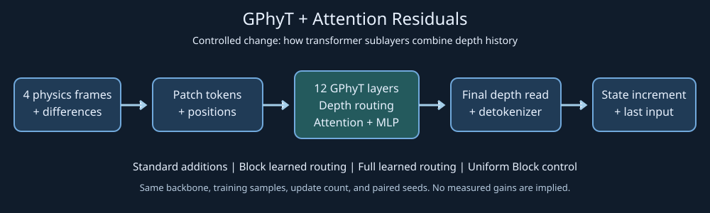
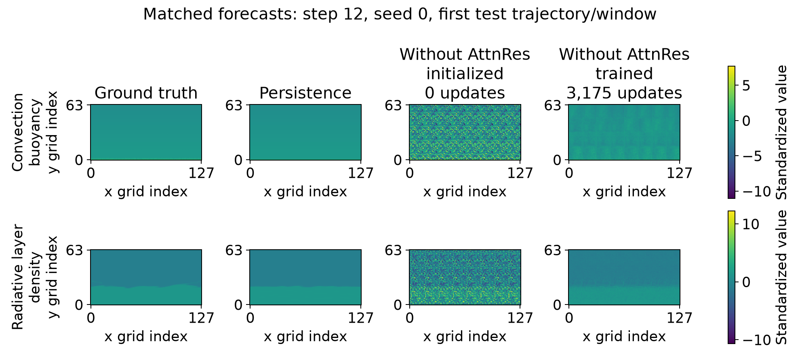
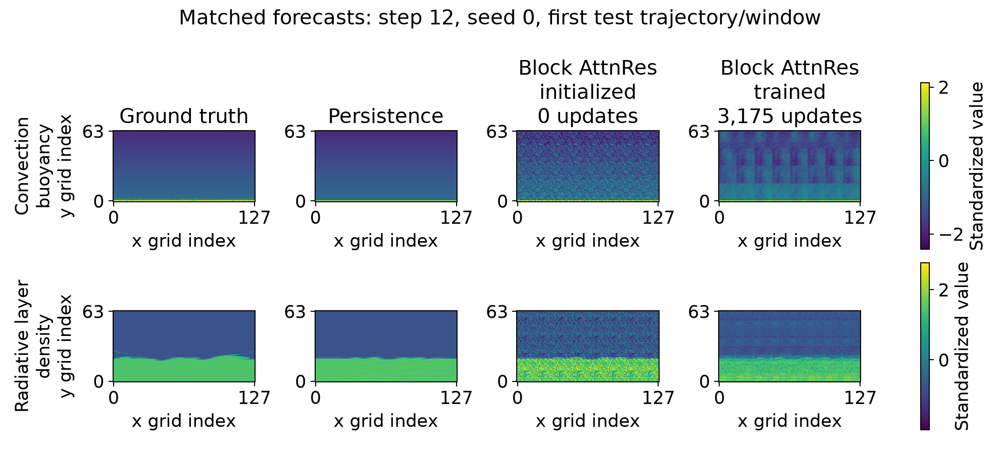
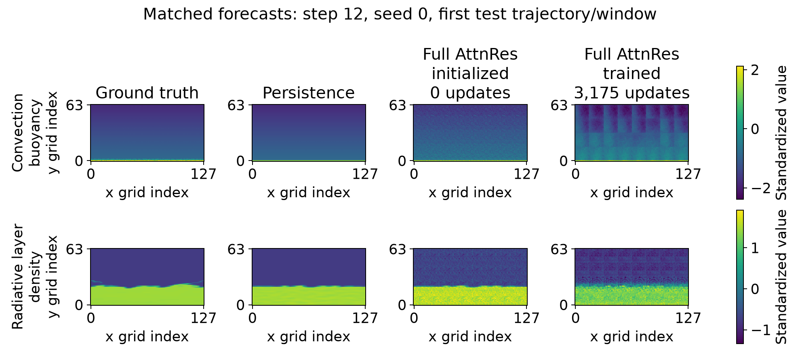
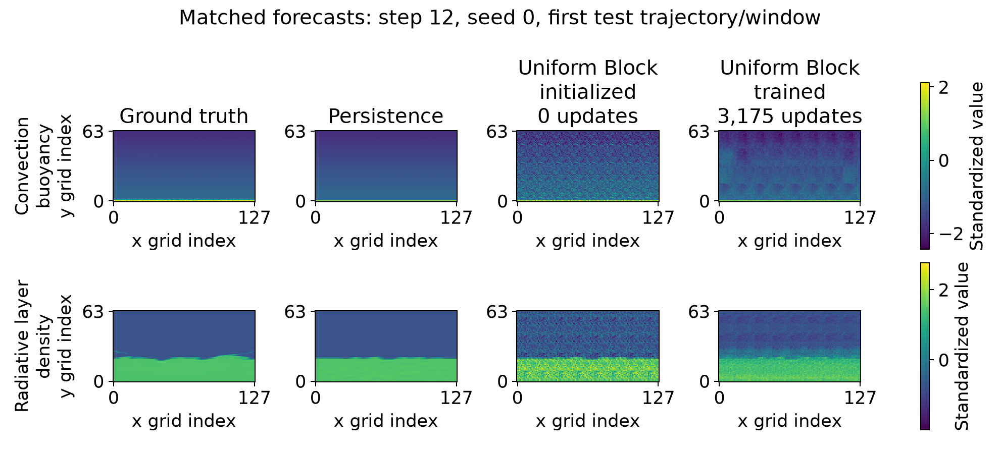
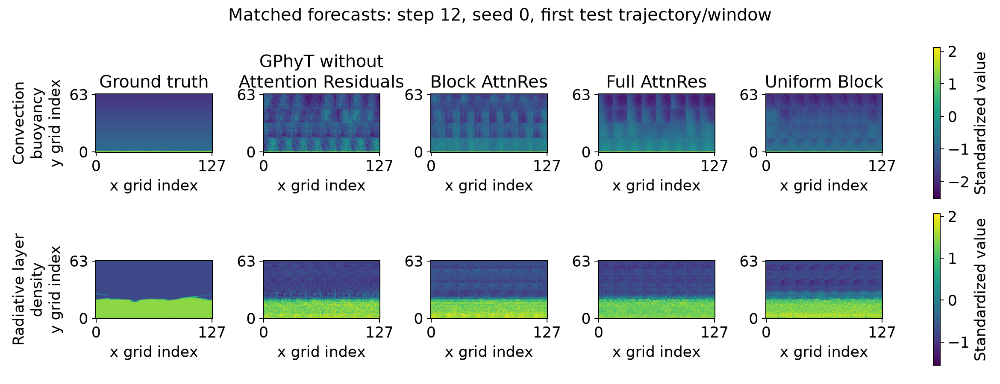
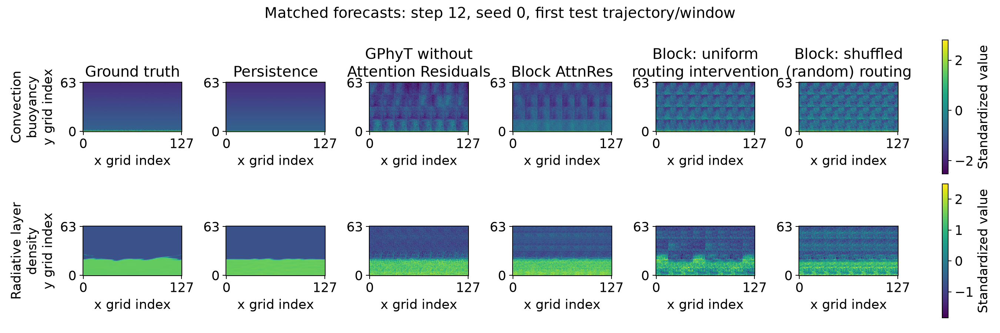
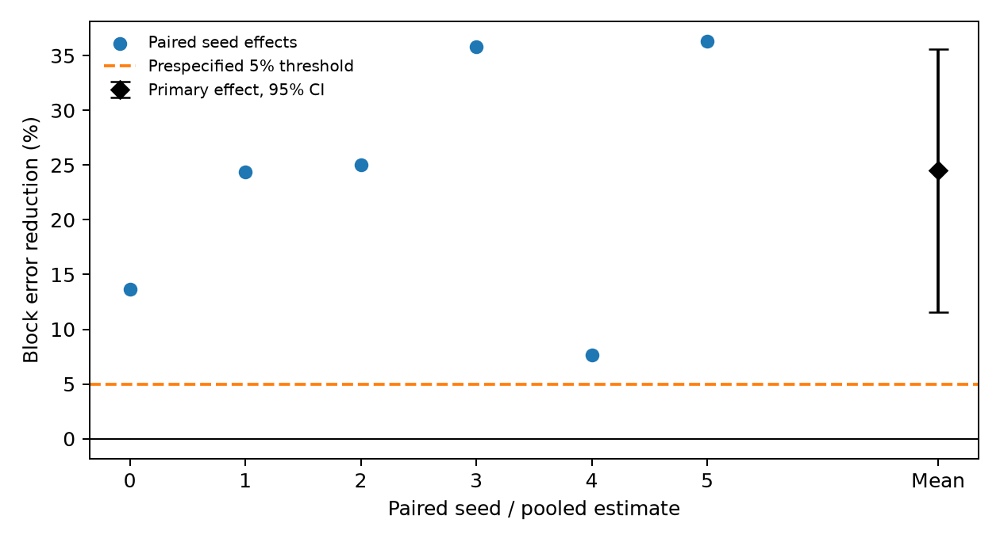
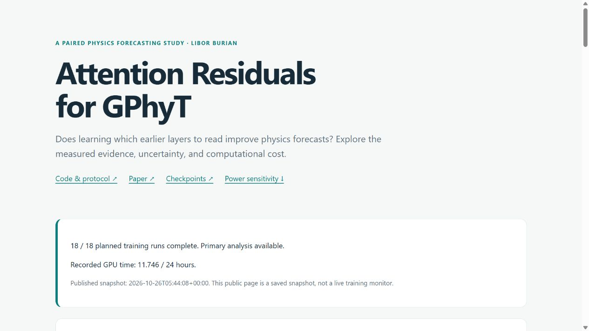
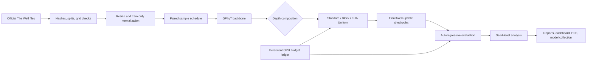

# GPhyT with and without Attention Residuals

A preregistered comparison of GPhyT **with Block Attention Residuals** against GPhyT **without Attention Residuals**, trained the same way from scratch on two physics datasets. It reuses the official GPhyT backbone and FLA's Attention Residuals operator and evaluates free-running forecasts across paired seeds. The complete local study is limited to **24 GPU-hours**.



**Headline result: Block Attention Residuals reduce the preregistered paired 12-step error endpoint by 24.52% versus GPhyT without Attention Residuals** (95% CI **11.56–35.58%**, exact paired **p = 0.03125**, six pairs). All six pairs favor Block. The baseline retains GPhyT's original additive residual connections and transformer self-attention; `standard` means **without Attention Residuals**, not without self-attention.

Both primary models use the same seeds **0–5**, identical shared backbone initialization and paired training examples, AdamW settings and learning-rate schedule, **3,175 optimizer updates**, effective batch **16**, BF16 autocast, and the same final-checkpoint evaluation. This matches the training procedure and update count; GPU time differs by architecture.

| Model | Role | Seeds | Convection 12-step NMSE ↓ | Radiative-layer 12-step NMSE ↓ |
|---|---|---:|---:|---:|
| **GPhyT without Attention Residuals** (`standard`) | Trained baseline | 6 | 39,284.16 | 0.39277 |
| **GPhyT + Block Attention Residuals** (`block`) | New method | 6 | 30,005.97 | 0.28917 |
| Full Attention Residuals | Exploratory architecture | 3 | 18,397.80 | 0.31735 |
| Uniform Block | Trained fixed-averaging control | 3 | 24,987.04 | 0.34735 |
| GPhyT without Attention Residuals, **untrained** | Initialized baseline (0 updates) | 6 | 350,741.97 | 7.02088 |
| Block Attention Residuals, **untrained** | Initialized baseline (0 updates) | 6 | 8,173.50 | 0.57270 |
| Full Attention Residuals, **untrained** | Initialized baseline (0 updates) | 3 | 1,332.00 | 0.41310 |
| Uniform Block, **untrained** | Initialized fixed-averaging control (0 updates) | 3 | 7,780.76 | 0.52484 |
| Persistence | Parameter-free baseline | deterministic | 0.21738 | 0.41901 |

Values cover the **full test population**, with arithmetic seed means from the [trained-model and persistence scores](reports/accuracy_summary.csv) and [untrained-model scores](reports/untrained/accuracy_summary.csv). The untrained rows are **post-hoc controls with zero optimizer updates**, evaluated on the same test population and architecture-specific seeds as their trained counterparts; they do not enter the original confirmatory comparison. The headline 24.52% uses the six primary pairs and equally weighted dataset **log-error ratios**, not the ratio of these table means. Standard and Block use seeds 0–5; Full and Uniform Block use seeds 0–2; persistence has no seed uncertainty. All horizons and uncertainty estimates appear in the [paper tables](paper/main.pdf).

**Where the methods got better or worse, in plain language:** “routing” means how the model mixes information from earlier layers.

- **Better than the original trained model:** Block made smaller average 12-step prediction errors on both physics datasets. Its combined primary error score was about a quarter lower. Full Attention Residuals also beat the original model on both datasets when comparing the same three seeds. [Measured errors](reports/metrics.csv).
- **Still much worse than a very simple baseline on convection:** persistence means predicting that the next frame will look exactly like the last observed frame. Every trained variant lost badly to this simple rule on convection under the study's fixed error measure. On radiative flow, Block and Full beat persistence at both 12 and 24 steps; Uniform Block beat it at 12 steps but fell behind at 24. [All forecast horizons](reports/accuracy_summary.csv).
- **Full versus Block was a tradeoff:** on the same three seeds, Full had lower 12-step error on convection but higher error on radiative flow than Block. These three-seed comparisons are exploratory; they do not establish a generally best architecture. [Matched runs](reports/metrics.csv).
- **Learning the routing weights did not clearly beat fixed averaging:** the trained Uniform Block control had lower convection error but higher radiative-flow error than Block on the same three seeds. Their combined comparison favored different methods for different seeds, so the extra benefit of learning these weights remains unresolved. [Paired control comparisons](reports/final_metric_audit.json).
- **Disrupting a trained Block model made it worse:** replacing its learned routing with equal weights or randomly shuffling those weights increased 12-step error in every tested seed/dataset comparison on the smaller diagnostic subset. The trained model uses its learned routing, but this does not establish that learning routing is better than training with fixed averaging from the start. [Matched intervention results](reports/interventions.csv).
- **Lower prediction error came with costs and physical mistakes:** Block and Full took longer to train and used more GPU memory than the original model in these runs. Block also produced more physically impossible negative-density cells than the original model in the 24-step radiative forecasts: 27.30% versus 26.04%. Better error scores therefore did not mean better behavior on every physical check. [Measured costs](reports/costs.csv) · [Physical diagnostics](reports/physical_diagnostics.csv).
- **The new untrained baselines expose a training failure on convection:** training lowered 12-step error for all four architectures on radiative flow. On convection, however, Block, Full, and Uniform Block became worse than their own initialized models in every tested seed; their mean errors increased by factors of **3.67, 13.81, and 3.21**, respectively. The model without Attention Residuals improved on both datasets, but still lost badly to persistence on convection. These later, explicitly post-hoc controls show why beating the trained baseline alone is insufficient. [Initialized-versus-trained evidence](reports/untrained/summary.md).

All 18 training runs and 31 original evaluations completed, but these forecasts are not physically reliable substitutes for a simulator. The conclusions apply to the tested datasets, resolution, model size, and training budget. See [interpretation and limitations](reports/interpretation.md), [all experiments](reports/summary.md), and [primary statistical results](reports/primary_analysis.json).

## Initialized versus trained models

<!-- initialization-results:start -->

**Post-hoc initialization-only controls: 18/18 evaluations complete.** These models have zero training updates and were reconstructed with the original constructor, frozen configuration, and seeds. They were requested after the trained results were known. Both columns use the same full test population and the same seeds for each architecture. Lower 12-step NMSE is better; finite/planned counts describe initialized seed endpoints.

| Dataset | Model | Finite/planned | Initialized (0 updates) | Trained (3,175 updates) |
| --- | --- | --- | --- | --- |
| Convection | GPhyT without AttnRes | 6/6 | 350742 | 39284.2 |
| Convection | Block AttnRes | 6/6 | 8173.5 | 30006 |
| Convection | Full AttnRes | 3/3 | 1332 | 18397.8 |
| Convection | Uniform Block | 3/3 | 7780.76 | 24987 |
| Radiative | GPhyT without AttnRes | 6/6 | 7.02088 | 0.392769 |
| Radiative | Block AttnRes | 6/6 | 0.572704 | 0.289174 |
| Radiative | Full AttnRes | 3/3 | 0.413095 | 0.317353 |
| Radiative | Uniform Block | 3/3 | 0.524838 | 0.347345 |

All 1/12/24-step scores, seed SDs, and descriptive intervals are in [the comparison CSV](reports/untrained/comparison.csv). Missing or divergent seeds remain undefined. The original six-pair primary comparison is unchanged. Block and Uniform have identical initial routing on their shared seeds 0–2; their overall means differ because Block also includes seeds 3–5. [Additional protocol](docs/untrained-baselines.md).









Examples use seed 0, first test trajectory/window, forecast step 12: convection buoyancy above, radiative density below. Each row has one common unclipped color range; magenta marks nonfinite predictions.

<!-- initialization-results:end -->

## Trained models and routing controls



**Matched visual examples:** ground truth and every trained variant use the same held-out case, seed 0, first test trajectory/window, and forecast step 12. Top: convection buoyancy (not temperature); bottom: radiative-layer density. Each row shares one color scale spanning all five panels without clipping; values are training-standardized. This comparison layout was added after results using the already fixed preview cases, rather than choosing cases by appearance. [Full-resolution figure](reports/figures/field_comparison.pdf) · [Interactive fields](https://burnycoder.github.io/general-physics-attention-residuals-transformer/#comparison).

**Fixed and random controls — matched diagnostic subset:** the same six trained Block checkpoints, evaluated on the first four test trajectories per dataset, without retraining.

| Model / routing control | Convection 12-step NMSE ↓ | Radiative-layer 12-step NMSE ↓ |
|---|---:|---:|
| Block, original routing on this subset | 17,550.77 | 0.29714 |
| Block, uniform-routing intervention | 42,767.76 | 2.16975 |
| Block, shuffled depth weights **(random control)** | 40,923.97 | 2.81369 |

Compare these arithmetic six-seed means **within this table**, not with the full-test table above. Uniform replaces routing with equal weights; the random control permutes learned source-depth weight assignments with fixed RNG seed 20261025. Neither is a separately trained random model; trained Uniform Block is listed in the full-test table. [Absolute scores, seed counts, SDs, and intervals](reports/intervention_accuracy_summary.csv) · [Per-seed matched scores and ratios](reports/interventions.csv).



These control examples reuse the same first cases and step 12 shown above, with a common unclipped color scale per row. Persistence repeats the final observed context frame; both intervention panels reuse saved forecasts from the same trained Block checkpoint. [Full-resolution control figure](reports/figures/control_comparison.pdf) · [Public control scores and examples](https://burnycoder.github.io/general-physics-attention-residuals-transformer/#controls).

[Paper](paper/main.pdf) · [Interactive results](https://burnycoder.github.io/general-physics-attention-residuals-transformer/) · [18 trained + 18 initialized checkpoints](https://huggingface.co/collections/BurnyCoder/gphyt-attention-residuals-6adee5fe6ceb5f9ae1ccb873) · [Fixed-case rollout videos](reports/videos)

The **[GPhyT without Attention Residuals baseline is on Hugging Face](https://huggingface.co/BurnyCoder/gphyt-attnres-standard)** with all six seed checkpoints, configurations, normalization statistics, training logs, and evaluation results. Its seed-0 checkpoint was downloaded, hash-checked, and re-evaluated; [release evidence](reports/publication.json) records the match.

All four repositories also contain the new **initialized, zero-update weights** under `untrained/seedN/model.safetensors`, with a separate `untrained/config.json`, provenance, and full-test errors. These reconstructed initializations are distinct from the trained `seedN/` checkpoints. Including this extension, the project used **12.208877 of 24 GPU-hours**, with 1.119727 of the two evaluation hours used. [Budget and verification](reports/untrained_baseline_verification.json).



Data preparation is complete: 240 trajectories from 36 official files. The [data audit](reports/data-preparation.md) found no exact complete-trajectory duplication across splits, but all test trajectories share their first frame with training at a different parameter setting. Claims therefore concern these official splits, not entirely unseen initial conditions.

The [measured schedule](reports/profiling.md) is frozen at **3,175 updates per run**, microbatch **4**, and effective batch **16**. Training used 11.068 GPU-hours against its 18-hour allocation; every run completed that schedule without a failure or omission. The complete [GPU ledger](reports/gpu_budget.json) includes profiling, evaluation, and checkpoint verification. The published Standard seed-0 checkpoint was downloaded, hash-checked, and re-evaluated successfully; see [release evidence](reports/publication.json).

The [independent architecture audit](reports/architecture-audit.md) found the intended GPhyT/AttnRes composition and disclosed a mixed-precision description error. Intervention arithmetic was corrected before test evaluation; the training computation and frozen schedule were preserved. All 16 neutral-intervention and FLA-parity checks subsequently passed on CUDA within the original validation allowance.

## Method and usage

The study uses GPhyT-S (12 layers, width 192, three heads) with either standard residuals, Block Attention Residuals, Full Attention Residuals, or fixed uniform Block routing. Training uses four frames to predict one future frame at 128x64. The primary outcome is 12-step autoregressive NMSE for the final fixed-update checkpoint, aggregated by trajectory, dataset, and paired seed. See the [complete frozen protocol](docs/protocol.md), [source review](docs/sources.md), and [completion checklist](docs/completion.md).

### Install

Windows with an NVIDIA GPU supporting the selected CUDA build is the execution target. The reference code and CPU tests also use ordinary PyTorch. Install [uv](https://docs.astral.sh/uv/getting-started/installation/), Git, and the GitHub/Hugging Face CLIs if publishing. Python 3.13 is managed by uv.

```powershell
git clone https://github.com/BurnyCoder/general-physics-attention-residuals-transformer
cd general-physics-attention-residuals-transformer
Copy-Item .env.example .env
uv sync --locked
```

Set `STUDY_ROOT` in `.env` to an artifact directory with at least 55 GB free. The study selects about 38.6 GB of raw HDF5 files and stores smaller processed arrays and checkpoints separately. Authentication belongs in `gh auth login` and `hf auth login`, not Git or configuration committed to the repository. The public dataset downloads need no login.

The default downloader uses bounded HTTP ranges. Optionally install [official aria2](https://github.com/aria2/aria2/releases) and set `ARIA2C` in `.env` to its executable for segmented transfers; `.tools/aria2c.exe` is also detected. See [storage and download details](docs/data-preparation.md). The raw data server can be slow; download time does not consume the GPU allowance.

### Pipeline commands

```powershell
uv run gphyt-study prepare
uv run pytest -q
uv run gphyt-study power
uv run gphyt-study verify
uv run gphyt-study profile
# Commit and push reports/frozen_protocol.json before the train phase.
uv run gphyt-study train
# Optional implementation audit, serialized under the same profiling/validation budget:
uv run --no-sync python scripts/verify_cuda_interventions.py
uv run gphyt-study evaluate
# Additional user-requested post-hoc controls: initialized models, zero training updates.
uv run --no-sync python -m gphyt_attnres_study untrained
uv run gphyt-study analyze
uv run gphyt-study report
uv run gphyt-study dashboard
uv run gphyt-study publish
```

Each phase resumes durable artifacts independently. `profile` requires completed preparation and freezes the common horizon; commit and push its generated protocol before `train`. The training runner restores model, optimizer, and RNG state, reconstructs the learning-rate schedule from the saved update, and preserves failed attempts. Do not delete the GPU ledger to restart the allowance. `report` also refreshes analysis; pending or divergent primary endpoints remain explicitly undefined. `publish` uploads completed checkpoints and verifies the first completed/evaluated checkpoint in the frozen execution order, normally Standard seed 0. This availability rule is fixed before training and never chooses by accuracy.

To replicate this study at its original update count, run `prepare`, then `uv run gphyt-study reproduce` **instead of `profile`**. Preparation reuses the published source manifest; `reproduce` checks a portable fingerprint of data hashes, split membership, coordinates, and training-only statistics before adopting `reports/frozen_protocol.json`. It does not overwrite a different locally frozen study. Retain the original locked environment and configuration; a fresh timing profile defines a separate budgeted experiment, not an exact replication of the original schedule.

For simultaneous long-running phases on Windows, synchronize once, then use `uv run --no-sync python -m gphyt_attnres_study PHASE`. This avoids attempting to replace a console-script executable that another process has open. Do not modify locked dependencies during active experiments.

GPU phases use a process-scoped Windows request to prevent automatic idle sleep; the display can still turn off, manual sleep remains possible, and the request is released when the phase exits. No persistent power-plan setting is changed. An independent supervisor enforces the phase and total compute deadlines even if a model call stops checking the cooperative budget.

The dashboard runs at [localhost:8501](http://127.0.0.1:8501). It provides run/dataset filters, loss and gradient curves, costs, field comparisons, routing heatmaps, and prospective power. It displays an explicit empty state until measurements exist.

The [public study explorer](https://burnycoder.github.io/general-physics-attention-residuals-transformer/) is a static GitHub Pages snapshot of the same saved evidence. `report` exports its tables, curves, routing weights, fixed-case field previews, and compiled paper into `site/`. Preview with `uv run --no-sync python -m http.server 8765 --bind 127.0.0.1 --directory site`. Merging changes to `site/` into `main` deploys through the Pages workflow; raw datasets, credentials, and local paths are excluded. The local dashboard additionally supports all active fields.

The completed dashboard and public viewer were checked against the saved metrics, including dataset/horizon filters, routing, and forecast frames; see [release verification](reports/final-verification.md).



### What happens when it runs

1. Download the selected official files and save their source revision, checksums, and split metadata.
2. Validate uniform grids and fields, detect duplicate trajectories, resize on CPU, and fit normalization on training trajectories only.
3. Publish prospective power sensitivity; profile all model variants and freeze a common update count.
4. Train six baseline/Block pairs, then three Full/Uniform controls with the same shared initialization and data schedules.
5. Evaluate fixed forecast windows, persistence, physical diagnostics, and routing interventions; analyze independent seed effects.
6. Generate reports, plots, videos, dashboard inputs, a paper, and publication-ready checkpoints.



## Features and technologies

- Pinned MIT-licensed GPhyT and FLA source with byte-level provenance.
- PyTorch/BF16 training, NumPy/HDF5 data, safetensors release weights, and resumable optimizer checkpoints.
- JSON experiment configuration, `.env` paths, `uv.lock`, timestamped complete process logs, and a shared GPU budget ledger.
- SciPy/statsmodels inference and power sensitivity; Matplotlib publication figures; Streamlit/Plotly exploration.
- LaTeX paper and Markdown experiment reports grounded in saved results.

The manuscript is in `paper/main.tex`. Before `report`, install [Tectonic](https://tectonic-typesetting.github.io/en-US/install.html) or pdfLaTeX and put it on PATH, or set `LATEX_EXECUTABLE` in `.env` to the compiler executable. `report` regenerates numerical results and figures, compiles the PDF, and exports the public viewer. The Codex LaTeX editor can also compile and preview the source. The completed 15-page paper reports measured results and limitations; every page was rendered and visually checked. Rendering tools are separate from the Python training environment.

## Reuse and scientific limits

Core references: [Towards a Physics Foundation Model](https://arxiv.org/abs/2509.13805), [Attention Residuals](https://arxiv.org/abs/2603.15031), [FLA reference code](https://github.com/fla-org/flash-linear-attention/blob/a400aff6ec0eb81cc88721aedba782cd7d535357/fla/ops/attnres/naive.py), and [The Well](https://arxiv.org/abs/2412.00568). Original licenses remain in `vendor/`; source links and implementation caveats are centralized in [docs/sources.md](docs/sources.md).

The model is trained from scratch on selected convection and radiative-flow simulations. This does not establish zero-shot generalization, foundation-model scale performance, exact conservation, or superiority over numerical solvers. The convection scalar is buoyancy, not temperature. Training failures and nonsignificant results remain part of the record.
