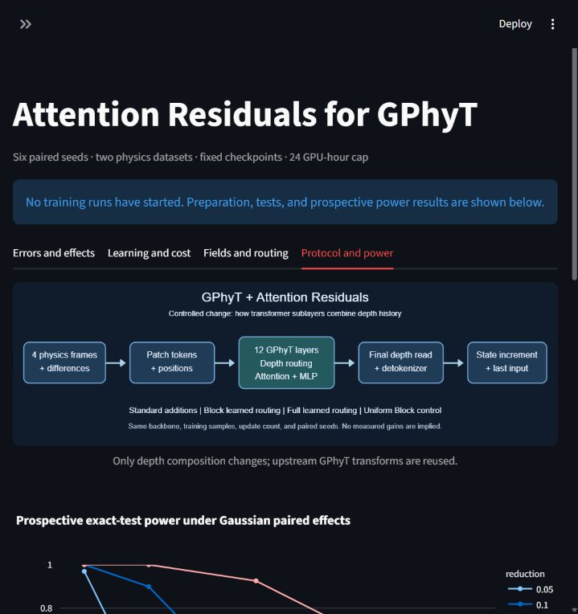
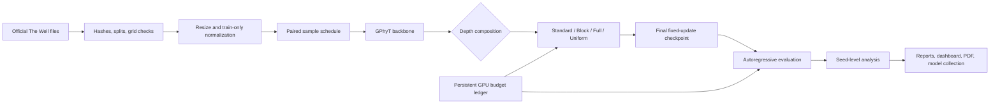

# Attention Residuals for the General Physics Transformer

A preregistered study of whether learned attention over network depth improves GPhyT's coarse-grid physics forecasts. It reuses the official GPhyT backbone and FLA's Attention Residuals operator, trains matched models on two physics datasets, and evaluates free-running forecasts across paired seeds. The complete local study is limited to **24 GPU-hours**.


**Results status: confirmatory training started on 2026-10-25; final held-out results are pending.** All four full-scale BF16 execution checks pass. Prospective power is limited: for a 5% improvement and assumed paired log-ratio SD 0.05, simulated exact-test power is 37.1%. These are verification and sensitivity results, not evidence of improved physics prediction. See the [execution record](reports/execution.md), [current experiment summary](reports/summary.md), [test record](reports/development.md), and [power assumptions](reports/power_sensitivity.json).

Data preparation is complete: 240 trajectories from 36 official files. The [data audit](reports/data-preparation.md) found no exact complete-trajectory duplication across splits, but all test trajectories share their first frame with training at a different parameter setting. Claims therefore concern these official splits, not entirely unseen initial conditions.

The [measured schedule](reports/profiling.md) is frozen at **3,175 updates per run**, microbatch **4**, and effective batch **16**. Its cost projection is 14.4 training hours for the complete 18-run matrix; actual costs and any budget omissions will be reported.

The [independent architecture audit](reports/architecture-audit.md) found the intended GPhyT/AttnRes composition and disclosed a mixed-precision description error. Intervention arithmetic was corrected before test evaluation; the running training computation and frozen schedule were preserved.

## Method and usage

The study uses GPhyT-S (12 layers, width 192, three heads) with either standard residuals, Block Attention Residuals, Full Attention Residuals, or fixed uniform Block routing. Training uses four frames to predict one future frame at 128x64. The primary outcome is 12-step autoregressive NMSE for the final fixed-update checkpoint, aggregated by trajectory, dataset, and paired seed. See the [complete frozen protocol](docs/protocol.md), [source review](docs/sources.md), and [completion checklist](docs/completion.md).

### Install

Windows with an NVIDIA GPU supporting the selected CUDA build is the execution target. The reference code and CPU tests also use ordinary PyTorch. Install [uv](https://docs.astral.sh/uv/getting-started/installation/), Git, and the GitHub/Hugging Face CLIs if publishing. Python 3.13 is managed by uv.

```powershell
git clone https://github.com/BurnyCoder/general-physics-attention-residuals-transformer
cd general-physics-attention-residuals-transformer
Copy-Item .env.example .env
uv sync --locked
```

Set `STUDY_ROOT` in `.env` to an artifact directory with at least 55 GB free. The study selects about 38.6 GB of raw HDF5 files and stores smaller processed arrays and checkpoints separately. Authentication belongs in `gh auth login` and `hf auth login`, not Git or configuration committed to the repository. The public dataset downloads need no login.

The default downloader uses bounded HTTP ranges. Optionally install [official aria2](https://github.com/aria2/aria2/releases) and set `ARIA2C` in `.env` to its executable for segmented transfers; `.tools/aria2c.exe` is also detected. See [storage and download details](docs/data-preparation.md). The raw data server can be slow; download time does not consume the GPU allowance.

### Pipeline commands

```powershell
uv run gphyt-study prepare
uv run pytest -q
uv run gphyt-study power
uv run gphyt-study verify
uv run gphyt-study profile
# Commit and push reports/frozen_protocol.json before the train phase.
uv run gphyt-study train
uv run gphyt-study evaluate
uv run gphyt-study analyze
uv run gphyt-study report
uv run gphyt-study dashboard
uv run gphyt-study publish
```

Each phase resumes durable artifacts independently. `profile` requires completed preparation and freezes the common horizon; commit and push its generated protocol before `train`. The training runner restores model, optimizer, and RNG state, reconstructs the learning-rate schedule from the saved update, and preserves failed attempts. Do not delete the GPU ledger to restart the allowance. `report` also refreshes analysis; pending or divergent primary endpoints remain explicitly undefined. `publish` uploads completed checkpoints and verifies the first completed/evaluated checkpoint in the frozen execution order, normally Standard seed 0. This availability rule is fixed before training and never chooses by accuracy.

To replicate this study at its original update count, run `prepare`, then `uv run gphyt-study reproduce` **instead of `profile`**. Preparation reuses the published source manifest; `reproduce` checks a portable fingerprint of data hashes, split membership, coordinates, and training-only statistics before adopting `reports/frozen_protocol.json`. It does not overwrite a different locally frozen study. Retain the original locked environment and configuration; a fresh timing profile defines a separate budgeted experiment, not an exact replication of the original schedule.

For simultaneous long-running phases on Windows, synchronize once, then use `uv run --no-sync python -m gphyt_attnres_study PHASE`. This avoids attempting to replace a console-script executable that another process has open. Do not modify locked dependencies during active experiments.

GPU phases use a process-scoped Windows request to prevent automatic idle sleep; the display can still turn off, manual sleep remains possible, and the request is released when the phase exits. No persistent power-plan setting is changed. An independent supervisor enforces the phase and total compute deadlines even if a model call stops checking the cooperative budget.

The dashboard runs at [localhost:8501](http://127.0.0.1:8501). It provides run/dataset filters, loss and gradient curves, costs, field comparisons, routing heatmaps, and prospective power. It displays an explicit empty state until measurements exist.

The [public study explorer](https://burnycoder.github.io/general-physics-attention-residuals-transformer/) is a static GitHub Pages snapshot of the same saved evidence. `report` exports its tables, curves, routing weights, fixed-case field previews, and compiled paper into `site/`. Preview with `uv run --no-sync python -m http.server 8765 --bind 127.0.0.1 --directory site`. Merging changes to `site/` into `main` deploys through the Pages workflow; raw datasets, credentials, and local paths are excluded. The local dashboard additionally supports all active fields.



### What happens when it runs

1. Download the selected official files and save their source revision, checksums, and split metadata.
2. Validate uniform grids and fields, detect duplicate trajectories, resize on CPU, and fit normalization on training trajectories only.
3. Publish prospective power sensitivity; profile all model variants and freeze a common update count.
4. Train six baseline/Block pairs, then three Full/Uniform controls with the same shared initialization and data schedules.
5. Evaluate fixed forecast windows, persistence, physical diagnostics, and routing interventions; analyze independent seed effects.
6. Generate reports, plots, videos, dashboard inputs, a paper, and publication-ready checkpoints.



## Features and technologies

- Pinned MIT-licensed GPhyT and FLA source with byte-level provenance.
- PyTorch/BF16 training, NumPy/HDF5 data, safetensors release weights, and resumable optimizer checkpoints.
- JSON experiment configuration, `.env` paths, `uv.lock`, timestamped complete process logs, and a shared GPU budget ledger.
- SciPy/statsmodels inference and power sensitivity; Matplotlib publication figures; Streamlit/Plotly exploration.
- LaTeX paper and Markdown experiment reports grounded in saved results.

The manuscript is in `paper/main.tex`. Before `report`, install [Tectonic](https://tectonic-typesetting.github.io/en-US/install.html) or pdfLaTeX and put it on PATH, or set `LATEX_EXECUTABLE` in `.env` to the compiler executable. `report` regenerates numerical results and figures, compiles the PDF, and exports the public viewer. The Codex LaTeX editor can also compile and preview the source. The current draft explicitly marks confirmatory results as pending. Rendering tools are separate from the Python training environment.

## Reuse and scientific limits

Core references: [Towards a Physics Foundation Model](https://arxiv.org/abs/2509.13805), [Attention Residuals](https://arxiv.org/abs/2603.15031), [FLA reference code](https://github.com/fla-org/flash-linear-attention/blob/a400aff6ec0eb81cc88721aedba782cd7d535357/fla/ops/attnres/naive.py), and [The Well](https://arxiv.org/abs/2412.00568). Original licenses remain in `vendor/`; source links and implementation caveats are centralized in [docs/sources.md](docs/sources.md).

The model is trained from scratch on selected convection and radiative-flow simulations. This does not establish zero-shot generalization, foundation-model scale performance, exact conservation, or superiority over numerical solvers. The convection scalar is buoyancy, not temperature. Training failures and nonsignificant results remain part of the record.
